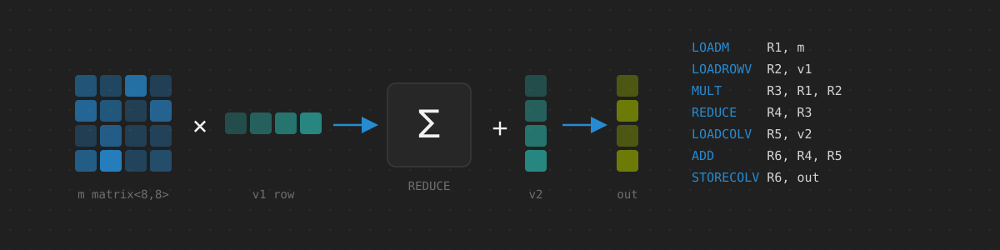

# tree-sitter-spar

A [tree-sitter](https://tree-sitter.github.io/) grammar for SPAR assembly
(`*.spar`), the assembly language of the
[SPAR](https://github.com/SPAR-Public) processor, with highlighting queries.
It supersedes tree-sitter-sparhl, the grammar of the earlier SPARHL language.

```
; Multiply a matrix by a vector and add a vector.
m = matrix<8,8> [1,2,3,4,5,6,7,8,
                 ...]
v1 = vector<8> [1,2,3,4,5,6,7,8]
v2 = vector<8> [1,2,3,4,5,6,7,8]
out = vector<8,8>

LOADM     R1, m
LOADROWV  R2, v1
MULT      R3, R1, R2
REDUCE    R4, R3
LOADCOLV  R5, v2
ADD       R6, R4, R5
STORECOLV R6, out

RETURN   out
```

## Language Coverage

* **Definitions**: numbers and typed tensors (`m = matrix<8,8> [...]`),
  with literals that may span lines.
* **Includes**: `#include "file.spar"`.
* **Instructions**: load, store, arithmetic, reduction, transposition, and
  activation operations on registers and tensors.
* **Labels**, and labeled instructions.
* **Indexed operands**: `m[i,j][tile,tile][1,1]`.
* **Structured loops**: `FOR ... TO ... STEP ... END`.
* **Affine maps**: map definitions (`#tile = MAP<d0, s0 -> FLOORDIV(d0, s0)>`),
  bindings (`n = MIN #tile(i, 4)`), and affine expressions with the functions
  `FLOORDIV`, `CEILDIV`, `MOD`, `MIN`, and `MAX`.
* **Comments**: `;` to the end of the line.

Keywords and tensor type names are case-insensitive. The grammar describes
the syntax of the language; the number and kinds of operands of each opcode
are checked by the SPAR assembler, not by the grammar.

## Neovim

Requirements: Neovim 0.12 or later and
[nvim-treesitter](https://github.com/nvim-treesitter/nvim-treesitter) on its
`main` branch, with the tree-sitter CLI and a C compiler.

### With gardener.nvim

With [gardener.nvim](https://github.com/tkamucheka/gardener.nvim) and
[lazy.nvim](https://github.com/folke/lazy.nvim), gardener detects `*.spar`
files, installs the parser when a file is first opened, and starts
highlighting:

```lua
{
  "tkamucheka/gardener.nvim",
  dependencies = { "nvim-treesitter/nvim-treesitter" },
  lazy = false,
  opts = {
    custom_parsers = {
      spar = {
        install_info = {
          url = "https://github.com/tkamucheka/tree-sitter-spar",
          queries = "queries",
        },
        extensions = { "spar" },
      },
    },
  },
}
```

### With nvim-treesitter Alone

Detect the filetype, register the parser in a `User TSUpdate` autocommand,
and start highlighting in SPAR buffers:

```lua
vim.filetype.add({ extension = { spar = "spar" } })

vim.api.nvim_create_autocmd("User", {
  pattern = "TSUpdate",
  callback = function()
    require("nvim-treesitter.parsers").spar = {
      install_info = {
        url = "https://github.com/tkamucheka/tree-sitter-spar",
        queries = "queries",
      },
    }
  end,
})

vim.api.nvim_create_autocmd("FileType", {
  pattern = "spar",
  callback = function()
    vim.treesitter.start()
  end,
})
```

Then install the parser with `:TSInstall spar`.

## Other Bindings

The repository contains bindings for C, Go, Node.js, Python, Rust, and Swift,
generated by the tree-sitter CLI. The C library builds with `make` or CMake.

## Development

```sh
git clone https://github.com/tkamucheka/tree-sitter-spar
cd tree-sitter-spar
tree-sitter generate   # regenerate src/ after editing grammar.js
tree-sitter test       # run the corpus tests in test/corpus
```

## License

MIT; see [LICENSE](LICENSE).
